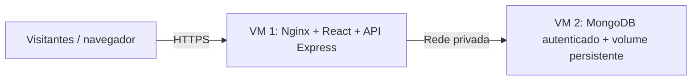
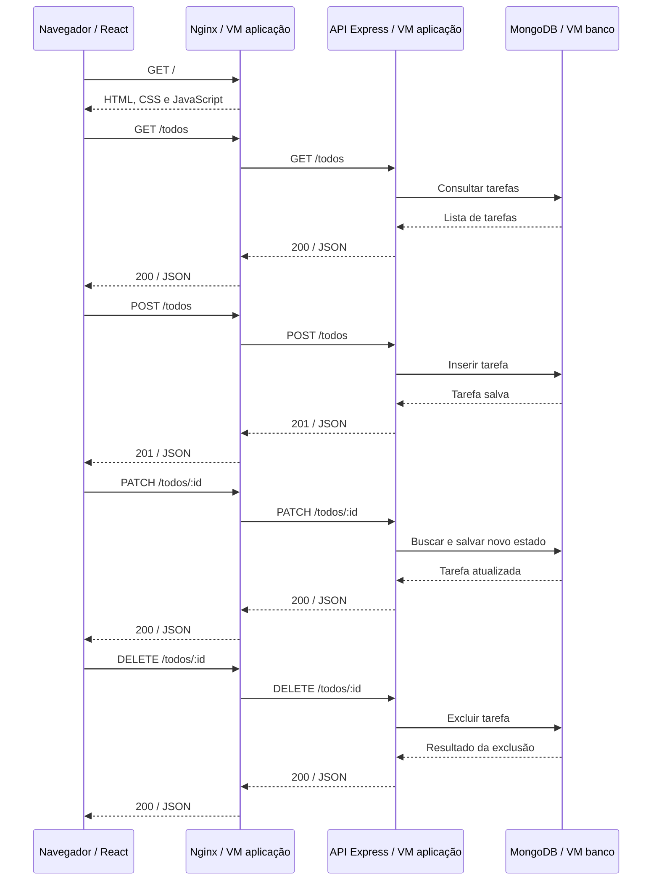

# Escopo

**ToDo App · Implantação e operação em nuvem para a Feira de Profissões**

**Cenário:** projeto acadêmico de alunos do 3º período de Engenharia de Software.
**Versão:** 1.0 · **Data:** 11/11/2026.

## Apresentação do projeto

### 1. Contexto

Alunos do **3º período de Engenharia de Software** desenvolveram o **ToDo App**, uma aplicação de lista de tarefas. Para apresentar o trabalho na **Feira de Profissões**, a equipe precisa disponibilizar o sistema na internet, permitindo que visitantes conheçam e utilizem a aplicação pelo navegador.

O projeto já pode ser executado localmente com Docker Compose. A equipe busca um profissional com capacidade de planejar a infraestrutura, adaptar as configurações de implantação e colocar a aplicação na nuvem, com procedimentos que os alunos consigam utilizar antes e durante a apresentação.

### 2. Objetivo da contratação

Entregar o ToDo App em um endereço público HTTPS, com frontend, API e banco integrados, preservação das tarefas e operação documentada para a feira. Seguindo o modelo do KubeShop, este escopo adota aplicação e banco em VMs distintas e administração da infraestrutura por pipelines.

| Decisão | Condição definida |
| --- | --- |
| Provedor e ferramentas | Escolha do profissional, com justificativa técnica e de custos. |
| Arquitetura mínima | Pelo menos duas VMs; MongoDB em uma VM exclusiva. |
| Automação | Criar pipelines de infraestrutura e um fluxo de validação e entrega da aplicação. |
| Custos e período | Estimar o custo mensal e o custo do período de preparação e realização da feira. |

### 3. Ponto de partida

Frontend React servido pelo Nginx, API Node.js/Express e MongoDB com dados iniciais de demonstração. A execução local da página e da API, incluindo a conexão ao banco, foi verificada com Docker Compose.

O sistema permite **cadastrar, listar, concluir, reabrir e excluir tarefas**. A lista é compartilhada entre os visitantes; não há login, separação por usuário ou edição do texto de tarefas. O repositório fornecido ainda não contém pipelines de CI/CD.

## Arquitetura e isolamento

### 4. Requisitos da solução

O provedor é livre. A arquitetura deverá manter a aplicação e o MongoDB em servidores distintos, com entrada pública pela aplicação e comunicação com o banco exclusivamente pela rede privada.

| Requisito | Aplicação no projeto |
| --- | --- |
| REQ-01 · Servidores | Provisionar no mínimo duas VMs. Dedicar uma ao MongoDB; justificar recursos adicionais. |
| REQ-02 · Rede privada | Liberar a porta do MongoDB apenas para a API na VM da aplicação. Não publicar o banco na internet. |
| REQ-03 · Acessos | Restringir a administração das VMs; usar credencial própria da aplicação no banco e manter segredos fora do código e dos logs. |
| REQ-04 · Persistência | Configurar armazenamento persistente, política de backup e restauração testada. Atualizações não poderão apagar as tarefas. |
| REQ-05 · Publicação | Oferecer URL HTTPS utilizável em outro dispositivo, com frontend e API acessíveis pelo mesmo endereço público. |
| REQ-06 · Disponibilidade | Configurar reinício dos serviços e verificações de saúde, incluindo a conexão da API ao banco. Documentar diagnóstico de falhas. |

### 5. Adaptações necessárias

Substituir as chamadas fixas a **localhost:5000** por uma configuração adequada à nuvem. Configurar o Nginx para encaminhar **/todos** e **/todos/:id** à API no mesmo endereço da interface, preservando os métodos e os caminhos existentes.

Configurar endereço privado do MongoDB e credenciais por ambiente; adaptar a implantação para dois hosts. O Compose atual publica a porta do banco, usa credenciais de demonstração e não define volume nomeado. Essas configurações deverão ser ajustadas, assim como o CORS aberto e a inicialização sem verificação de prontidão.

## Fluxo da aplicação

### 6. Fluxo funcional do ToDo App

O diagrama representa a **implantação proposta**. O Nginx entrega a interface e encaminha as operações à API. Somente a API acessa o MongoDB. Na base local atual, o navegador chama diretamente a API em localhost:5000.

**Comportamento:** a interface consulta a lista ao abrir a página. Adicionar cria uma tarefa pendente; clicar no texto alterna entre concluída e reaberta; Excluir remove a tarefa. As alterações retornadas pela API atualizam a tela. Recarregar consulta novamente o banco; não há sincronização automática entre navegadores.

**Uso na feira:** todos acessam a mesma lista e podem alterar ou excluir tarefas. Utilizar somente dados de demonstração e orientar os visitantes sobre esse comportamento. A preparação de uma nova lista para cada apresentação deve ser documentada e executada de forma intencional.

## Pipelines e operação

### 7. Responsabilidades de automação

| Fluxo | Entrega esperada |
| --- | --- |
| Entrega da aplicação | Criar um fluxo mínimo de validação, construção das imagens e implantação de versões identificáveis, com retorno à versão anterior documentado. |
| Pipelines de infraestrutura | Automatizar criação, configuração, alteração e desativação dos recursos, além das rotinas operacionais previstas neste escopo. |

### 8. Infraestrutura como código

Versionar VMs, rede privada, regras de acesso e armazenamento. A solução deverá reproduzir o ambiente a partir dos arquivos e parâmetros documentados. O profissional escolherá as ferramentas e explicará as decisões; quando houver estado de infraestrutura, documentará sua proteção, armazenamento e recuperação.

### 9. Operações que os pipelines devem atender

| Operação | Comportamento esperado |
| --- | --- |
| Validar e planejar | Verificar configurações e apresentar as alterações previstas antes de executar. |
| Provisionar e configurar | Criar os recursos, preparar as VMs e configurar os serviços e seus acessos. |
| Implantar e atualizar | Publicar versões identificadas, verificar a saúde e documentar recuperação em caso de falha. |
| Manter e diagnosticar | Oferecer rotinas de reinício, consulta de saúde e acesso aos logs. |
| Proteger e recuperar | Automatizar backups e disponibilizar rotina de restauração testada. |
| Desativar | Encerrar os recursos após a feira, explicitando o destino dos dados e os itens que continuam gerando cobrança. |

### 10. Operação pelos alunos

Documentar como executar as rotinas, os parâmetros necessários, os resultados esperados e a resposta a falhas comuns. Separar reinício de serviços, limpeza intencional da lista e remoção de infraestrutura. As execuções deverão gerar evidências sem revelar credenciais.

## Proposta técnica e custos

### 11. Autonomia do profissional

O profissional escolherá provedor, região, tipos de VM e ferramentas. A justificativa deverá relacionar dimensionamento, facilidade de operação pelos alunos, limites da solução e custos à apresentação na feira.

> **Premissas para a proposta:** data da feira, duração, quantidade estimada de visitantes simultâneos, conta de nuvem e disponibilidade de domínio ainda não foram informadas. Registrar hipóteses de dimensionamento e confirmar esses dados com a organização antes de definir a janela operacional.

### 12. Conteúdo da estimativa

| Item | Informações necessárias |
| --- | --- |
| Premissas | Provedor, região, moeda, data dos preços, horas de uso e período de preparação, evento e encerramento. |
| Máquinas virtuais | Quantidade, função, CPU, memória e justificativa do dimensionamento de cada VM. |
| Dados e backups | Capacidade dos volumes, retenção, cópias, restauração e armazenamento que permanece após o evento. |
| Rede e serviços auxiliares | Tráfego, endereços IP e, quando cobrados, DNS, domínio, certificados, logs e execução de pipelines. |
| Total e justificativa | Custo mensal de referência e custo do período de uso, com fontes de preços, limitações e fatores de variação. |

Créditos e faixas gratuitas deverão aparecer separadamente do custo recorrente. A estimativa compõe a proposta técnica; não há valor de orçamento definido neste documento. O uso de recursos reais deverá respeitar os limites da conta disponibilizada para a atividade.

### 13. Responsabilidades e limites

- **Alunos:** fornecem o código, explicam o funcionamento e participam da validação e da passagem de conhecimento.
- **Organização da feira:** informa data, janela de apresentação, expectativa de público e responsáveis pela conta e pelo endereço de acesso.
- **Profissional:** entrega arquitetura, implantação, automação, custos, evidências e procedimentos de operação e encerramento.
- **Limites:** adaptações de configuração e implantação fazem parte da entrega. Login, listas individuais, novas funcionalidades de negócio e suporte permanente não são exigidos.

## Roadmap e entregáveis

### 14. Sequência de execução

Planejar as etapas de modo que o ensaio e a validação ocorram antes da feira. A data do evento e os marcos de entrega deverão ser registrados quando informados pela organização.

| Etapa | Entrega esperada |
| --- | --- |
| 1 · Diagnóstico | Revisão do repositório, execução de referência e levantamento das configurações que precisam mudar. |
| 2 · Proposta técnica | Arquitetura, escolhas justificadas, dimensionamento e estimativa mensal e do período da feira. |
| 3 · Infraestrutura como código | Definição das duas VMs, rede privada, regras de acesso e armazenamento persistente. |
| 4 · Pipelines | Automação de infraestrutura, validação, construção e entrega da aplicação, com segredos protegidos. |
| 5 · Publicação | Aplicação e banco em VMs distintas; integração pelo endereço público HTTPS e verificação de saúde. |
| 6 · Operação e recuperação | Backup automatizado, restauração testada, diagnóstico e procedimentos para os alunos. |
| 7 · Ensaio e entrega | Testes em outro dispositivo, evidências de aceite e demonstração conduzida pelos alunos antes da feira. |
| 8 · Encerramento | Procedimento validado de desativação; após o evento, inventário do que foi removido e do que permanece gerando custo. |

### 15. Pacote final de entrega

- Documento de arquitetura com diagramas, decisões, limitações, premissas e estimativa de custos.
- Código de infraestrutura, configurações e pipelines versionados, com instruções de execução.
- URL HTTPS e inventário dos recursos, versões implantadas e responsáveis pelos acessos; segredos entregues por meio apropriado.
- Manual para os alunos: iniciar, verificar, atualizar, consultar logs, recuperar dados, preparar a demonstração e encerrar.
- Relatório de validação com evidências do fluxo funcional, isolamento, persistência, automação e restauração.

## Critérios de aceite

### 16. Evidências para conclusão da entrega

Cada critério deverá ser demonstrado por uma execução, registro ou documento verificável. Capturas de tela poderão complementar os registros; a página inicial acessível, isoladamente, não comprova a integração da solução.

| Critério | Evidência esperada |
| --- | --- |
| ACE-01 · Reprodução | Ambiente criado a partir do código e dos pipelines, com pré-requisitos e parâmetros documentados. |
| ACE-02 · Duas VMs | Inventário com pelo menos duas VMs e MongoDB em servidor exclusivo. |
| ACE-03 · Isolamento | API conectada ao banco pela rede privada e tentativa externa demonstrando que a porta do MongoDB não está acessível. |
| ACE-04 · Aplicação pública | Em outro dispositivo, abrir a URL HTTPS, cadastrar, listar, concluir, reabrir e excluir uma tarefa; recarregar e conferir o resultado. |
| ACE-05 · Persistência | Tarefa e estado preservados após reinício, recriação do container do banco com o volume mantido e atualização da aplicação. |
| ACE-06 · Automação | Execuções dos pipelines de infraestrutura e de entrega da aplicação, com versão identificada e recuperação documentada. |
| ACE-07 · Recuperação | Backup automatizado executado e restauração conferida em ambiente isolado, sem sobrescrever a demonstração principal. |
| ACE-08 · Operação | Verificações de saúde, logs, reinício e procedimento de desativação disponíveis; credenciais ausentes do código e dos registros. |
| ACE-09 · Custos | Estimativa mensal e do período da feira, com premissas, fontes e recursos que podem continuar gerando cobrança após o evento. |
| ACE-10 · Transferência | Alunos demonstram o fluxo e executam as rotinas essenciais com o manual, incluindo diagnóstico e preparação da lista da apresentação. |

### 17. Definição de conclusão

A implantação estará pronta para a feira quando a URL pública funcionar, o banco estiver isolado e persistente, a automação e a recuperação estiverem verificadas e os alunos conseguirem conduzir o ensaio com a documentação. O encerramento dos recursos ocorrerá após o período de uso acordado.

> **Resultado esperado:** os alunos apresentam o projeto na Feira de Profissões e os visitantes experimentam a aplicação pela internet, com infraestrutura reproduzível, custos conhecidos e procedimentos acessíveis à equipe.
